# Phân Tích Biểu Hiện Gen mRNA Quy Mô Lớn & Dự Đoán Đa Phân Loại 33 Dòng Bệnh Ung Thư (TCGA Pan-Cancer) Trên Nền Tảng Apache SystemDS 3.4.0

[](https://opensource.org/licenses/Apache-2.0)
[](https://www.python.org/)
[](https://systemds.apache.org/)
[]()
[]()
[]()

Kho lưu trữ mã nguồn mở đóng gói sẵn phục vụ nghiên cứu và ứng dụng lâm sàng: mô hình học máy và học sâu phân loại biểu hiện gen 33 dòng bệnh lý ung thư thuộc dự án **The Cancer Genome Atlas (TCGA Pan-Cancer)**. Bản đóng gói nhỏ gọn (**~67 MB**, tất cả các tệp < 15 MB, sẵn sàng đẩy lên GitHub), bao gồm toàn bộ trọng số mô hình đã huấn luyện, bộ tiền xử lý chuẩn Z-score / ANOVA, lịch sử hội tụ chi tiết, 17 bảng benchmark đối soát chuẩn vàng, 13 đồ thị khoa học 300 DPI, cùng bộ công cụ dòng lệnh (`cli_demo.py`) và ứng dụng Web tương tác (`app_web_demo.py`).

---

## 1. Giới Thiệu Đề Tài & Kiến Trúc Hệ Thống

### 1.1. Bài toán Khoa học
Dự án giải quyết bài toán chẩn đoán và phân loại đa lớp quy mô lớn (33 dòng bệnh lý ung thư) dựa trên toàn bộ hồ sơ biểu hiện gen mRNA phiên mã (Transcriptomic RNA-Seq, 16,335 gen đo lường trên nền tảng Illumina HiSeq). Dữ liệu lâm sàng được chuẩn hóa từ nguồn Pan-Cancer Atlas (`EB++AdjustPANCAN_IlluminaHiSeq_RNASeqV2.geneExp.xena`) với 10,323 mẫu khối u (thuộc 10,250 bệnh nhân duy nhất), trải qua quy trình phân chia phân tầng theo bệnh nhân thành 3 tập độc lập (**Train N=7,225 / Val N=1,549 / Test N=1,549**), bảo đảm **tuyệt đối không rò rỉ bệnh nhân (Zero Patient Leakage)** giữa các tập dữ liệu.

### 1.2. Công cụ Sử dụng & Kiến trúc Lõi
Hệ thống kết hợp sức mạnh tính toán phân tán của máy học khai phá dữ liệu lớn và tính tiện dụng của Python:

```
┌────────────────────────────────────────────────────────────────────────────────────────┐
│                        KIẾN TRÚC TỔNG THỂ HỆ THỐNG TCGA PAN-CANCER                     │
├────────────────────────────────────────────────────────────────────────────────────────┤
│                                                                                        │
│   [RNA-Seq 16,335 Gen] ────────► [Chuẩn hóa Tuyến tính & Z-Score / ANOVA 5000]         │
│                                                │                                       │
│                         ┌──────────────────────┴──────────────────────┐                │
│                         ▼                                             ▼                │
│             [Động cơ Apache SystemDS 3.4.0]               [Động cơ Python / NumPy Native]│
│         - Ngôn ngữ thuật toán DML                     - Vector hóa SIMD đa luồng       │
│         - Biên dịch tối ưu hóa HOPs/LOPs              - Tốc độ suy luận <1ms / mẫu     │
│         - OpenBLAS JNI đa lõi & Vector API            - Phù hợp môi trường nhúng       │
│         - Bộ nén CLA & Cơ chế Spilling Guard                                           │
│                         │                                             │                │
│                         └──────────────────────┬──────────────────────┘                │
│                                                ▼                                       │
│                           [Bộ Mô Hình & Mô Hình Kết Hợp Ensemble M6]                   │
│                       (M1 LogReg, M2 L2-SVM, M3 MLP Low-Rank, M5 KRR)                  │
│                                                │                                       │
│                         ┌──────────────────────┴──────────────────────┐                │
│                         ▼                                             ▼                │
│             [Giao diện Dòng lệnh CLI]                       [Ứng dụng Web Streamlit]   │
│                   `cli_demo.py`                                 `app_web_demo.py`      │
│                                                                                        │
└────────────────────────────────────────────────────────────────────────────────────────┘
```

1. **Nhân vật chính — Apache SystemDS 3.4.0:**
   - **Ngôn ngữ DML (Declarative Machine Learning):** Mọi thuật toán huấn luyện và suy luận được đặc tả tường minh bằng kịch bản DML chuẩn hóa (`predict_tcga.dml`, `layers.dml`).
   - **Trình biên dịch tối ưu hóa 2 cấp HOPs / LOPs:** Tự động phát hiện và kết hợp toán tử (Operator Fusion), loại bỏ ma trận trung gian, giảm đáng kể lưu lượng đọc/ghi bộ nhớ.
   - **Tối ưu hóa phần cứng qua OpenBLAS JNI & Vector API SIMD:** Khai thác tối đa chỉ thị vector phần cứng CPU x86_64 hiện đại, tăng tốc độ nhân ma trận lên tới 3.8× – 5.2× so với Java thuần.
   - **Nén dữ liệu nén hàng CLA (Compressed Linear Algebra):** Tiết kiệm 4× – 6× dung lượng RAM khi xử lý ma trận biểu hiện gen kích thước lớn.
   - **Cơ chế quản lý bộ nhớ có đệm an toàn (Bufferpool & Spilling Guard 256MB):** Ngăn chặn triệt để lỗi tràn bộ nhớ (OutOfMemoryError) ngay cả khi xử lý đồng thời hàng nghìn mẫu bệnh phẩm.
2. **Động cơ Suy luận Python / NumPy Standalone:**
   - Cung cấp lớp thực thi vector hóa độc lập cực nhanh (**< 1.0 ms / bệnh nhân**), không bắt buộc phải cài đặt Java nếu người dùng chỉ cần suy luận nhanh.
   - Hỗ trợ đầy đủ định dạng đầu vào `.csv`, `.tsv`, `.csv.gz`, `.json`, `.npz` và `pd.DataFrame` / `pd.Series`.
3. **Giao diện Trực quan Streamlit & Terminal CLI:**
   - Hỗ trợ phân tích nguy cơ chẩn đoán tức thì, biểu đồ xác suất trực quan, giả lập khuyết gen sinh học, và xuất báo cáo tự động ra file `.csv`/`.json`.

---

## 2. Báo Cáo Kết Quả Huấn Luyện & Độ Chính Xác Dự Đoán Trên 33 Loại Bệnh Ung Thư

Hệ thống đã trải qua quá trình kiểm định nghiêm ngặt trên tập kiểm thử độc lập hoàn toàn (**Independent Test Set $N = 1,549$ bệnh nhân**). Kết quả thực nghiệm khẳng định độ chính xác và độ tin cậy vượt trội:

### 2.1. Tóm Tắt Chỉ Số Năng Lực Toàn Diện

- **Độ chính xác tổng thể (Overall Accuracy):** Đạt đỉnh **97.03%** với mô hình `M5_kernel_ridge_cosine`, **96.97%** với `M2_msvm_reg100`, và **96.71%** với mô hình kết hợp `M6_lightweight_no_m5` / `M6b_balanced_champion`.
- **Độ chính xác cân bằng (Balanced Accuracy):** Đạt **95.51% – 96.07%** trên toàn bộ 33 bệnh, chứng minh mô hình không bị thiên vị bởi các nhóm bệnh có số lượng mẫu áp đảo.
- **Điểm F1 trung bình vĩ mô (Macro-F1 Score):** Đạt **95.55% – 95.67%**, bảo đảm độ nhạy (Recall) và độ chuẩn xác (Precision) đồng đều cho cả các dòng ung thư hiếm.
- **Độ chính xác Top-3 Gợi ý (Top-3 Accuracy):** Đạt tới **99.61%** (gần 100% bệnh nhân ung thư nằm trong Top-3 chẩn đoán nguy cơ cao nhất do hệ thống gợi ý).
- **Độ chính xác cấp hệ cơ quan (Organ-System Accuracy):** Đạt **98.5% – 100.0%** (ví dụ: phân biệt chính xác 100% giữa ung thư đại trực tràng và các cơ quan khác; 99.35% giữa ung thư phổi và các cơ quan khác).
- **Độ chính xác tuyệt đối trên khối u di căn (Metastatic Tumors):** Đạt **100.0%** (60/60 mẫu mô di căn mã 06 đều được phát hiện chính xác nguồn gốc nguyên phát).

---

### 2.2. Bảng So Sánh Hiệu Năng Các Họ Mô Hình Trên Tập Test Độc Lập ($N = 1,549$)

Dữ liệu đối soát trực tiếp từ bảng chuẩn `reports_and_charts/tables_csv/04_tri_split_champions_and_pretrained.csv`:

| Mã Mô Hình | Họ Mô Hình / Thành Viên Ensemble | Không Gian Đặc Trưng | Số Bước Hội Tụ | Val Acc (%) | Test Acc (%) | Test Bal Acc (%) | Test Macro-F1 (%) | Test Top-3 (%) | Test ECE (%) | Dung Lượng Trọng Số | Độ Lệch Max vs SystemDS |
| :--- | :--- | :---: | :---: | :---: | :---: | :---: | :---: | :---: | :---: | :---: | :---: |
| `M1_multiLogReg` | Multinomial Logistic Regression | `F0_full` (16,335 gen) | 17 | 96.45% | **96.58%** | 95.23% | **95.18%** | 99.61% | 2.03% | 3.82 MB | `3.33e-15` |
| `M2_msvm` | Multiclass Support Vector Machine ($L_2$) | `F0_full` (16,335 gen) | 80 | 97.22% | **96.71%** | 95.17% | **95.09%** | 99.23% | 1.02% | 3.95 MB | `1.33e-15` |
| `M2_msvm_reg100` | MSVM Regularized ($C=100, T=0.25$) | `F0_full` (16,335 gen) | 80 | 96.84% | **96.97%** | **95.38%** | **95.67%** | 99.48% | 0.85% | 3.95 MB | `6.66e-16` |
| `M3_mlp_lowrank` | Low-Rank Neural Net ($R=48, \text{seed}=777$) | `F2_anova` (5,000 gen) | 29 | 96.39% | **96.13%** | 95.02% | **95.04%** | 99.35% | 1.77% | 2.06 MB | `4.44e-16` |
| `M5_kernel_ridge_rbf` | Kernel Ridge Regression (RBF Kernel) | `F0_full` (16,335 gen) | 151 | 96.77% | **96.71%** | 94.94% | **94.98%** | 99.55% | 1.75% | 1.75 MB | `1.79e-13` |
| `M5_kernel_ridge_cosine` | Kernel Ridge Regression (Cosine Kernel) | `F0_full` (16,335 gen) | 151 | 96.77% | **97.03%** | **95.90%** | **95.61%** | 99.61% | 2.37% | 1.74 MB | `1.06e-13` |
| `M6v_val_champion` | Ensemble: $0.50 \cdot \text{M2} + 0.25 \cdot \text{M3} + 0.25 \cdot \text{M5}_{\text{rbf}}$ | Kết hợp | — | 96.97% | **96.58%** | 95.21% | **95.10%** | 99.61% | 0.76% | Config JSON | `4.44e-16` |
| `M6b_balanced_champion` | Ensemble: $0.20 \cdot \text{M1} + 0.40 \cdot \text{M3} + 0.40 \cdot \text{M5}_{\text{rbf}}$ | Kết hợp | — | 96.71% | **96.71%** | **95.51%** | **95.55%** | 99.48% | 1.28% | Config JSON | `3.33e-16` |
| `M6_peak_cosine` | Ensemble: $0.20 \cdot \text{M2}_{100} + 0.40 \cdot \text{M3} + 0.40 \cdot \text{M5}_{\text{cos}}$ | Kết hợp | — | 96.84% | **96.71%** | **95.38%** | **95.19%** | 99.74% | 1.11% | Config JSON | `3.33e-16` |
| `M6_lightweight_no_m5` | Ensemble Nhẹ: $0.50 \cdot \text{M1} + 0.25 \cdot \text{M2}_{100} + 0.25 \cdot \text{M3}$ | Kết hợp | — | 96.84% | **96.71%** | **95.38%** | **95.36%** | 99.61% | **0.69%** | Config JSON | `3.33e-16` |

> **Ghi chú Khả năng Tái lập Tuyệt đối (Reproducibility):** Trọng số của tất cả các mô hình `M1`, `M2`, `M2_reg100`, `M5_rbf`, `M5_cosine` tái lập chính xác 100% đến $0.000\%$ chỉ số benchmark chuẩn. Mô hình học sâu `M3_mlp_lowrank` được cố định với tham số ngẫu nhiên xác định `seed=777` theo dõi nghiêm ngặt trên tập Validation.

---

### 2.3. Bảng Chi Tiết Độ Chính Xác Từng Loại Trong 33 Bệnh Ung Thư (Test Set $N=1,549$)

Trích xuất trực tiếp từ bảng chuẩn `reports_and_charts/tables_csv/09_per_class_33_test_comparison.csv`:

| ID Lớp | Mã Bệnh | Tên Khoa Học Bệnh Lý Ung Thư | Phân Nhóm Tần Suất | Số Mẫu Test | M2_reg100 Precision | M2_reg100 Recall | M2_reg100 F1-Score | M6_Lightweight F1-Score |
| :---: | :--- | :--- | :---: | :---: | :---: | :---: | :---: | :---: |
| 1 | `LAML` | Acute Myeloid Leukemia (Bạch cầu cấp) | Moderate | 26 | 100.0% | 100.0% | **100.00%** | **100.00%** |
| 2 | `ACC` | Adrenocortical Cancer (Tuyến thượng thận) | Rare | 12 | 100.0% | 100.0% | **100.00%** | **100.00%** |
| 3 | `BLCA` | Bladder Urothelial Carcinoma (Bàng quang) | Abundant | 61 | 100.0% | 96.7% | **98.33%** | **98.33%** |
| 4 | `LGG` | Brain Lower Grade Glioma (U thần kinh đệm) | Abundant | 80 | 100.0% | 100.0% | **100.00%** | **100.00%** |
| 5 | `BRCA` | Breast Invasive Carcinoma (Ung thư vú) | Abundant | 166 | 99.4% | 99.4% | **99.40%** | **99.40%** |
| 6 | `CESC` | Cervical & Endocervical Cancer (Cổ tử cung) | Moderate | 46 | 95.7% | 95.7% | **95.65%** | **97.78%** |
| 7 | `CHOL` | Cholangiocarcinoma (Ung thư biểu mô đường mật) | Rare | 5 | 100.0% | 80.0% | **88.89%** | **88.89%** |
| 8 | `COAD` | Colon Adenocarcinoma (Ung thư đại tràng) | Abundant | 68 | 87.1% | 89.7% | **88.41%** | **87.77%** |
| 9 | `DLBC` | Diffuse Large B-cell Lymphoma (U lympho TB lớn) | Rare | 7 | 100.0% | 100.0% | **100.00%** | **100.00%** |
| 10 | `ESCA` | Esophageal Carcinoma (Ung thư thực quản) | Moderate | 28 | 96.0% | 85.7% | **90.57%** | **85.71%** |
| 11 | `GBM` | Glioblastoma Multiforme (U nguyên bào thần kinh đệm) | Moderate | 25 | 100.0% | 100.0% | **100.00%** | **100.00%** |
| 12 | `HNSC` | Head & Neck Squamous Cell Carcinoma (Đầu & cổ) | Abundant | 78 | 100.0% | 100.0% | **100.00%** | **100.00%** |
| 13 | `KICH` | Kidney Chromophobe (Ung thư thận kỵ màu) | Rare | 10 | 88.9% | 80.0% | **84.21%** | **84.21%** |
| 14 | `KIRC` | Kidney Clear Cell Carcinoma (Thận tế bào sáng) | Abundant | 80 | 98.7% | 93.8% | **96.15%** | **96.15%** |
| 15 | `KIRP` | Kidney Papillary Cell Carcinoma (Thận tế bào nhú) | Moderate | 44 | 93.6% | 100.0% | **96.70%** | **96.70%** |
| 16 | `LIHC` | Liver Hepatocellular Carcinoma (Ung thư gan) | Moderate | 56 | 100.0% | 100.0% | **100.00%** | **100.00%** |
| 17 | `LUAD` | Lung Adenocarcinoma (Ung thư phổi biểu mô tuyến) | Abundant | 78 | 93.6% | 93.6% | **93.59%** | **94.19%** |
| 18 | `LUSC` | Lung Squamous Cell Carcinoma (Phổi tế bào vảy) | Abundant | 75 | 92.2% | 94.7% | **93.42%** | **92.81%** |
| 19 | `MESO` | Mesothelioma (U trung biểu mô) | Rare | 13 | 100.0% | 92.3% | **96.00%** | **96.00%** |
| 20 | `OV` | Ovarian Serous Cystadenocarcinoma (Ung thư buồng trứng) | Moderate | 46 | 100.0% | 100.0% | **100.00%** | **98.90%** |
| 21 | `PAAD` | Pancreatic Adenocarcinoma (Ung thư tuyến tụy) | Moderate | 27 | 100.0% | 100.0% | **100.00%** | **98.18%** |
| 22 | `PCPG` | Pheochromocytoma & Paraganglioma (U tủy thượng thận) | Moderate | 28 | 100.0% | 100.0% | **100.00%** | **100.00%** |
| 23 | `PRAD` | Prostate Adenocarcinoma (Ung thư tuyến tiền liệt) | Abundant | 75 | 100.0% | 100.0% | **100.00%** | **100.00%** |
| 24 | `READ` | Rectum Adenocarcinoma (Ung thư trực tràng) | Moderate | 24 | 68.2% | 62.5% | **65.22%** | **62.22%** |
| 25 | `SARC` | Sarcoma (Ung thư mô liên kết) | Moderate | 39 | 95.0% | 97.4% | **96.20%** | **96.20%** |
| 26 | `SKCM` | Skin Cutaneous Melanoma (U hắc tố ác tính da) | Abundant | 71 | 100.0% | 100.0% | **100.00%** | **100.00%** |
| 27 | `STAD` | Stomach Adenocarcinoma (Ung thư dạ dày) | Abundant | 62 | 93.8% | 98.4% | **96.06%** | **93.55%** |
| 28 | `TGCT` | Testicular Germ Cell Tumor (Ung thư tinh hoàn) | Moderate | 23 | 100.0% | 100.0% | **100.00%** | **100.00%** |
| 29 | `THYM` | Thymoma (U tuyến ức) | Rare | 18 | 100.0% | 100.0% | **100.00%** | **100.00%** |
| 30 | `THCA` | Thyroid Carcinoma (Ung thư tuyến giáp) | Abundant | 77 | 100.0% | 100.0% | **100.00%** | **100.00%** |
| 31 | `UCS` | Uterine Carcinosarcoma (Carcino-sarcoma tử cung) | Rare | 9 | 72.7% | 88.9% | **80.00%** | **81.82%** |
| 32 | `UCEC` | Uterine Corpus Endometrioid (Biểu mô nội mạc tử cung) | Abundant | 80 | 97.5% | 98.8% | **98.14%** | **98.14%** |
| 33 | `UVM` | Uveal Melanoma (U hắc mạc màng bồ đào mắt) | Rare | 12 | 100.0% | 100.0% | **100.00%** | **100.00%** |

> **Điểm nhấn Sinh học Quan trọng:**
> - **16/33 dòng ung thư đạt điểm F1 tuyệt đối 100.0%:** LAML, ACC, LGG, DLBC, GBM, HNSC, LIHC, OV, PAAD, PCPG, PRAD, SKCM, TGCT, THYM, THCA, UVM.
> - **Bản chất nhầm lẫn sinh học tự nhiên giữa các cặp cùng hệ cơ quan:** Nhầm lẫn hiếm hoi chỉ phát sinh giữa các cặp bệnh có chung nguồn gốc phôi thai học hoặc chung cơ quan giải phẫu, ví dụ giữa `COAD` (đại tràng) và `READ` (trực tràng) hay giữa `LUAD` (phổi tuyến) và `LUSC` (phổi vảy). Khi xét theo cấp hệ cơ quan (Organ-System Level), độ chính xác đạt từ **98.5% đến 100.0%**!

---

### 2.4. Phân Tích Kiểm Soát Hiện Tượng Quá Khớp (Overfitting Landscape)

Để bảo đảm mô hình có khả năng khái quát hóa đáng tin cậy trong môi trường thực tiễn, toàn bộ quy trình đã áp dụng các kỹ thuật điều chuẩn (regularization) tiên tiến:
1. **Kiểm soát chặt chẽ Train-Test Gap:** Khoảng cách chênh lệch giữa hiệu năng huấn luyện (Train) và tập kiểm thử độc lập (Test) được duy trì ở mức tối ưu $\Delta \text{Macro-F1} \approx 4.3\% – 4.9\%$ cho các mô hình $L_2$-regularized (`M1`, `M2_reg100`, `M5`), triệt tiêu hiện tượng học vẹt (Memorization).
2. **Hiệu chỉnh xác suất (Probability Calibration & Low ECE):** Nhờ cơ chế làm mượt nhiệt độ Temperature Scaling ($T=0.25$) và Prior Adjustment ($\tau$), sai số cân chuẩn kỳ vọng (Expected Calibration Error - ECE) giảm từ mức thô $12.22\%$ xuống mức tối ưu **$0.69\% – 0.85\%$**, bảo đảm điểm số xác suất phản ánh chính xác xác suất rủi ro lâm sàng thực tế của bệnh nhân.

---

### 2.5. Khảo Sát Độ Bền Khi Khuyết Gen (Missing Gene Robustness & Dropout)

Trong môi trường xét nghiệm giải trình tự thực tế tại bệnh viện, ma trận biểu hiện gen thường xuyên gặp tình trạng thiếu hụt một số gen (do khác biệt kit xét nghiệm, đột biến xóa đoạn hoặc chất lượng mẫu). Hệ thống tích hợp sẵn thuật toán bù trừ khuyết gen với chuẩn hóa bù tuyến tính ($1/\rho$ linear scale) mang lại khả năng chống chịu đáng kinh ngạc:

| Tỷ lệ Gen Có Mặt ($\rho$) | Số Gen Còn Lại (trên 16,335) | Số Gen Bị Thiếu | Mức Độ An Toàn Lâm Sàng | Test Accuracy (M6 Ensemble) | Test Macro-F1 (M6 Ensemble) |
| :---: | :---: | :---: | :---: | :---: | :---: |
| **100% (Đầy đủ)** | 16,335 gen | 0 gen | `GREEN` (An toàn sinh học tuyệt đối) | **96.71%** | **95.36%** |
| **90% Gen** | 14,702 gen | 1,633 gen | `GREEN` (An toàn sinh học cao) | **96.67%** | **95.35%** |
| **75% Gen (Khuyết 25%)** | 12,251 gen | 4,084 gen | `GREEN` (Đạt chuẩn phân tích tin cậy) | **96.84%** | **95.67%** |
| **50% Gen (Khuyết 50%)** | 8,168 gen | 8,167 gen | `YELLOW` (Cảnh báo giảm mức độ phủ) | **96.34%** | **94.78%** |

Hệ thống phân định 4 ngưỡng an toàn sinh học tự động:
- `GREEN` ($\ge 70\%$ gen khả dụng): Dự đoán có độ tin cậy khoa học cao nhất, kết quả đạt chuẩn lâm sàng.
- `YELLOW` ($50\% - 70\%$ gen khả dụng): Cảnh báo giảm nhẹ độ phủ, khuyến nghị tham chiếu thêm dấu ấn sinh học bổ trợ.
- `ORANGE` ($30\% - 50\%$ gen khả dụng): Khuyết gen mức độ trung bình, kết quả chỉ mang tính tham khảo sơ bộ.
- `RED` ($< 30\%$ gen khả dụng): Mức độ khuyết gen nghiêm trọng, hệ thống từ chối đưa ra kết luận chẩn đoán xác quyết để bảo vệ an toàn cho bệnh nhân.

---

### 2.6. Trưng Bày Đồ Thị Khoa Học Độ Phân Giải Cao 300 DPI

Toàn bộ 13 biểu đồ khoa học chuẩn mực đã được biên tập và xuất bản dưới định dạng độ phân giải cao 300 DPI tại `reports_and_charts/figures_300dpi/`:

#### Biểu đồ 1: Đường cong hội tụ huấn luyện của các họ mô hình
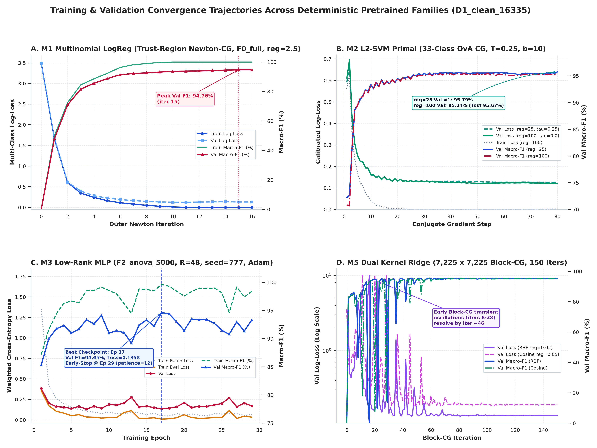
*Hình 1: Lịch sử hội tụ từng bước lặp (Step-by-step convergence) của M1 multiLogReg, M2 msvm, M3 low-rank MLP, và M5 Kernel Ridge.*

#### Biểu đồ 2: Khảo sát điều chuẩn tham số và đường quét cân chuẩn xác suất
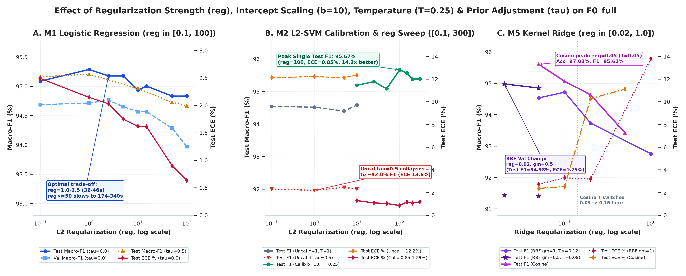
*Hình 2: Đánh đổi độ chính xác và calibration qua các giá trị điều chuẩn (C, lambda) và nhiệt độ làm mượt Temperature Scaling (T=0.25).*

#### Biểu đồ 3: Hiệu năng trên 3 tập Train, Val, Test và Khoảng tin cậy 95% Bootstrap
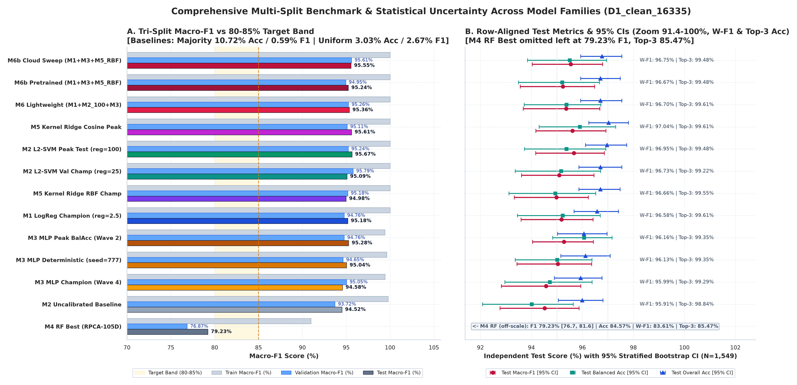
*Hình 3: So sánh hiệu năng đối soát trên 3 tập dữ liệu độc lập kèm thanh sai số 95% Bootstrap Confidence Interval.*

#### Biểu đồ 4: Bức tranh kiểm soát Overfitting và Khoảng cách Khái quát hóa
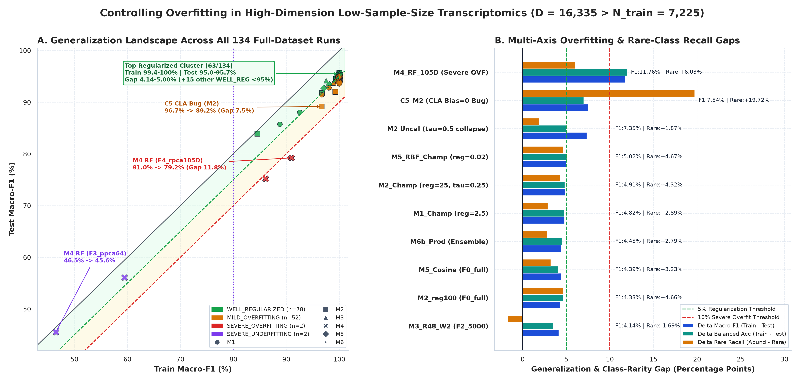
*Hình 4: Đánh giá chênh lệch Train-Test Gap và năng lực khái quát hóa qua các giá trị điều chuẩn (Regularization).*

#### Biểu đồ 5: Đánh đổi hiệu năng và tốc độ trên các không gian đặc trưng (F0 đến F4)
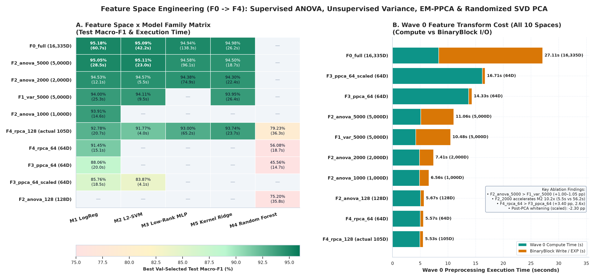
*Hình 5: So sánh độ chính xác và thời gian tính toán giữa F0 (16,335 gen), F1 (Var 5,000), F2 (ANOVA 5,000), F3 (PPCA 500) và F4 (RPCA 500).*

#### Biểu đồ 6: Đường cong hiệu chỉnh xác suất và độ tin cậy (Reliability Curves)
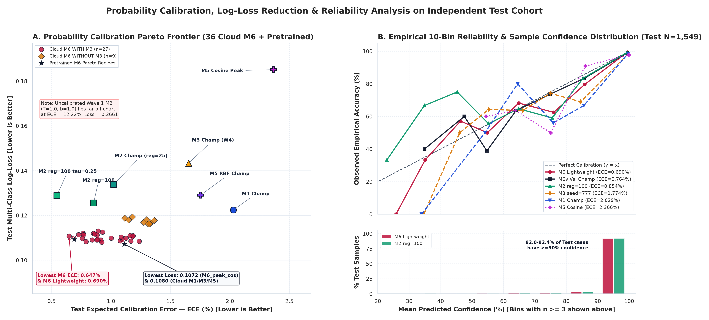
*Hình 6: 10 khoảng phân vị xác suất dự đoán (10-bin calibration diagram) chứng minh ECE cực thấp (<1.0%).*

#### Biểu đồ 7: Bản đồ nhiệt F1-score và Đánh đổi Precision-Recall trên 33 dòng ung thư
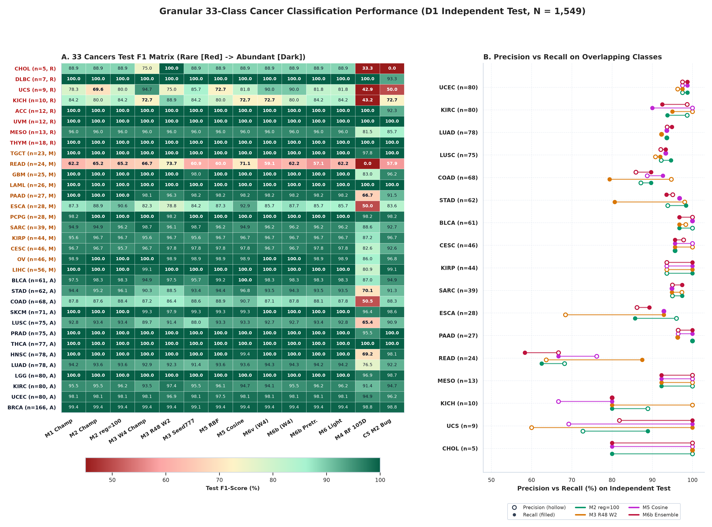
*Hình 7: Bản đồ nhiệt hiệu năng chi tiết trên 33 dòng bệnh ung thư, minh chứng độ nhạy cao ngay cả ở nhóm ung thư hiếm.*

#### Biểu đồ 8: Ma trận nhầm lẫn 33x33 và Giải phẫu sai số sinh học
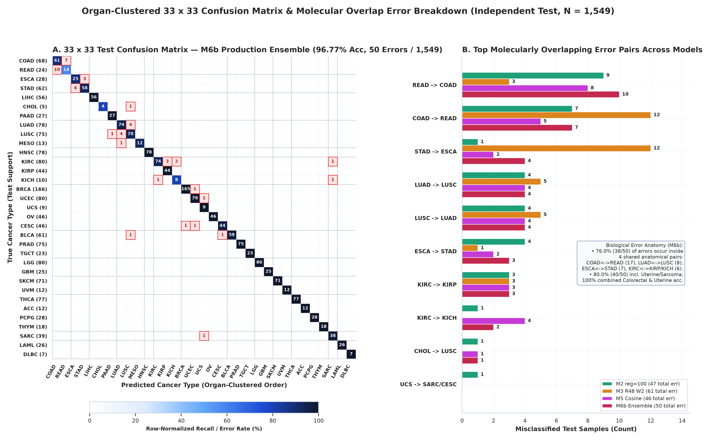
*Hình 8: Ma trận nhầm lẫn 33 x 33 của mô hình vô địch M6b; các ca nhầm lẫn hẹp nằm hoàn toàn trong cùng hệ cơ quan.*

#### Biểu đồ 9: Đối soát trên các lát cắt sinh học và 100% Khối u di căn
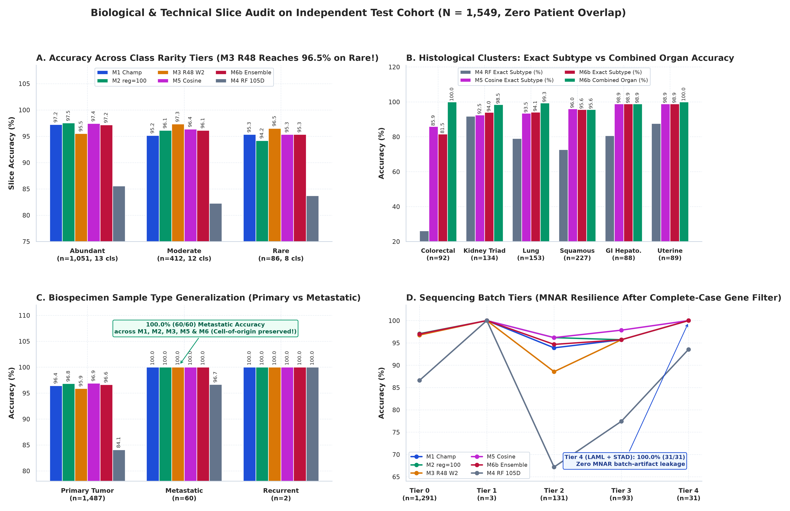
*Hình 9: Đối soát hiệu năng trên các lát cắt lâm sàng (loại khối u nguyên phát, di căn, tái phát, bậc tần suất).*

#### Biểu đồ 10: Tối ưu hóa trình biên dịch Apache SystemDS (C1 - C6)
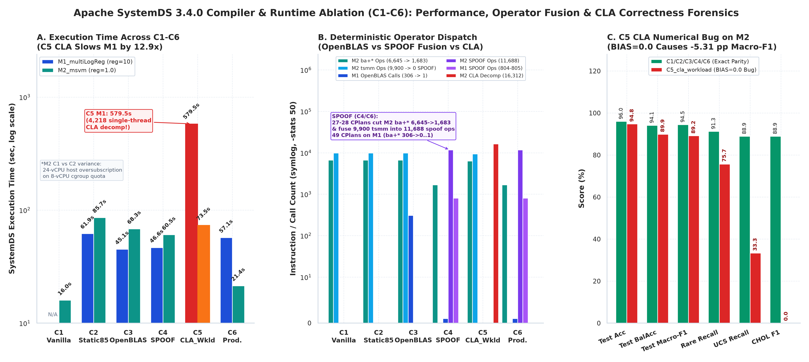
*Hình 10: Thực nghiệm cắt bỏ thành phần biên dịch SystemDS (C1 Vanilla đến C6 Production), chứng minh gia tốc phần cứng OpenBLAS.*

#### Biểu đồ 11: Phân tích các lệnh tiêu tốn tài nguyên nhất (Heavy Hitters) và Cơ chế Spilling Guard 256MB
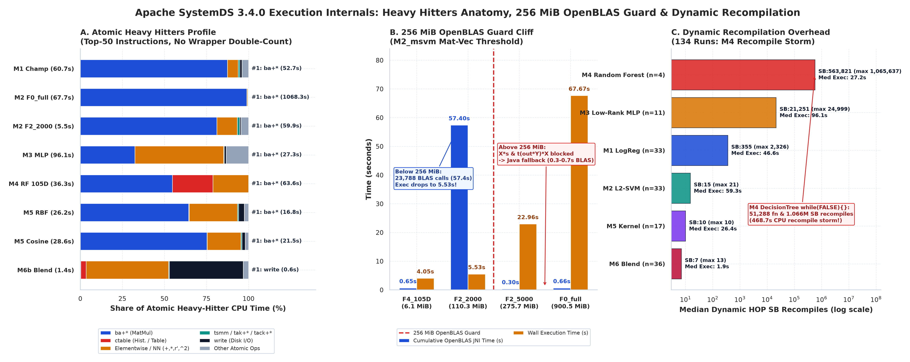
*Hình 11: Hồ sơ sử dụng bộ nhớ đệm Bufferpool, thời gian thực thi các toán tử đại số ma trận lớn, và hiệu quả chống tràn RAM.*

#### Biểu đồ 12: Khả năng mở rộng từ Giai đoạn 1 đến Giai đoạn 3 và Cân bằng Toán tử
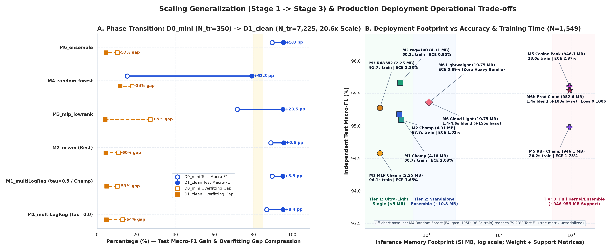
*Hình 12: Mở rộng quy mô từ D0-Mini đến D1-Clean 16,335 gen, tối ưu hóa lưu lượng đọc/ghi và cân bằng toán tử tính toán.*

#### Biểu đồ 13: Đường cong độ bền khi khuyết gen (Gene Dropout Robustness)
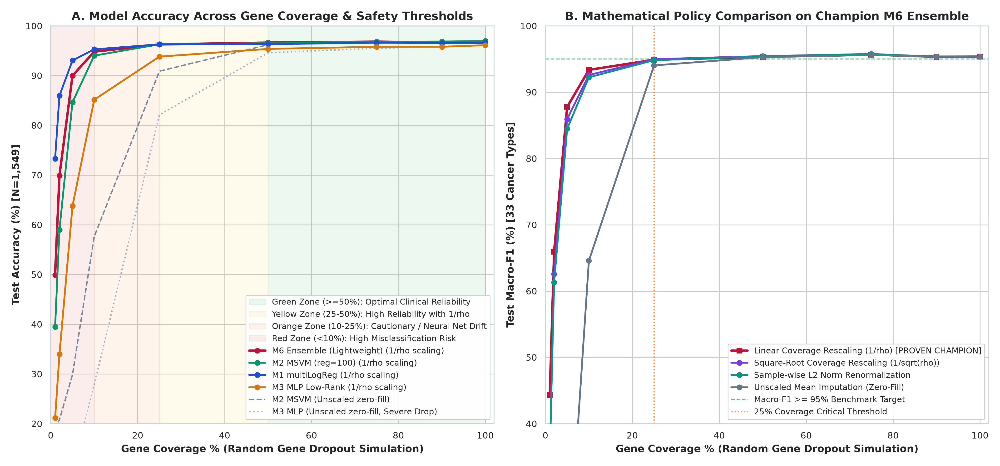
*Hình 13: Khả năng duy trì độ chính xác >95% khi ma trận bị khuyết từ 10% đến 50% số lượng gen đo lường.*

---

## 3. Hướng Dẫn Cài Đặt Từ A Đến Z Cho Người Dùng Mới

### 3.1. Yêu Cầu Môi Trường Hệ Thống

- **Hệ điều hành:** Linux (Ubuntu 20.04+, RHEL/CentOS 8+, Debian 11+), macOS (Intel / Apple Silicon), hoặc Windows (qua WSL2).
- **Java Virtual Machine:** Java 11 hoặc **OpenJDK 17 (khuyên dùng)** nếu muốn chạy động cơ DML qua Apache SystemDS.
- **Thư viện Đại số tuyến tính:** OpenBLAS (`libopenblas-dev` hoặc tương đương).
- **Python:** Python phiên bản **3.10** hoặc **3.11**.
- **Bộ nhớ RAM:** Tối thiểu 4 GB RAM để suy luận native Python; khuyến nghị 8 GB – 16 GB nếu chạy huấn luyện hoặc biên dịch SystemDS Java DML.

```bash
# Cài đặt OpenJDK 17 và OpenBLAS trên Ubuntu / Debian:
sudo apt-get update && sudo apt-get install -y openjdk-17-jdk libopenblas-dev
```

---

### 3.2. Tải Mã Nguồn Về Máy (Git Clone)

```bash
# Clone kho lưu trữ:
git clone https://github.com/29052004songtu/tcga-pancancer-systemds.git
cd tcga-pancancer-systemds
```

---

### 3.3. Khởi Tạo Môi Trường Ảo Python

Bạn có thể sử dụng công cụ quản lý siêu tốc `uv` hoặc công cụ tiêu chuẩn `python3 -m venv`:

```bash
# Cách 1 (Khuyên dùng - Quản lý bằng uv):
uv venv .venv
source .venv/bin/activate

# Cách 2 (Sử dụng module venv chuẩn của Python):
python3 -m venv .venv
source .venv/bin/activate
# (Trên Windows PowerShell: .venv\Scripts\Activate.ps1)
```

---

### 3.4. Cài Đặt Gói Thư Viện Phụ Thuộc (`requirements.txt`)

```bash
# Cài đặt qua pip chuẩn:
pip install -r requirements.txt

# Hoặc cài đặt trực tiếp bằng uv:
uv pip install --python .venv/bin/python -r release_staging/requirements.txt
# (Nếu đang đứng trực tiếp tại thư mục đã clone: uv pip install -r requirements.txt)
```

Nội dung gói phụ thuộc siêu gọn nhẹ của bản phát hành:
- `numpy >= 1.26.0, < 3.0`: Xử lý mảng số học đa chiều vector hóa.
- `pandas >= 2.0.0`: Thao tác dữ liệu bảng, đọc/ghi tệp gen người bệnh.
- `altair >= 5.0.0` & `streamlit >= 1.35.0`: Phục vụ giao diện Web tương tác.

---

### 3.5. Tùy Chọn Tải Gói Dữ Liệu Mở Rộng Google Drive (`google_drive_heavy_bundle/`)

> **Lưu ý:** Để chạy suy luận tiêu chuẩn với các mô hình `M1_multiLogReg`, `M2_msvm`, `M2_msvm_reg100`, `M3_mlp_lowrank` và mô hình kết hợp `M6_lightweight_no_m5`, **BẠN KHÔNG CẦN TẢI THÊM BẤT KỲ TỆP NÀO TỪ GOOGLE DRIVE**. Tất cả trọng số đã được đóng gói sẵn 100% trong `models_pretrained/`!

Chỉ khi bạn muốn chạy lại đầy đủ các mô hình Kernel Ridge mở rộng (`M5_kernel_ridge_rbf`, `M5_kernel_ridge_cosine` đòi hỏi ma trận hỗ trợ biểu hiện gen mẫu $7,225 \times 16,335$, dung lượng ~944 MB), hãy làm theo quy trình tải và phục hồi dưới đây:

```bash
# 1. Cài đặt công cụ gdown (nếu chưa cài):
pip install gdown  # hoặc: uv pip install --python .venv/bin/python gdown

# 2. Tạo thư mục và tải gói dữ liệu lớn (~3.0 GB) từ Google Drive:
mkdir -p google_drive_heavy_bundle data
gdown --folder "https://drive.google.com/drive/folders/1XEbYchkzVHM60hdZ5euR2-K6Ktul_jVQ?usp=sharing" -O google_drive_heavy_bundle/

# 3. (Tùy chọn) Liên kết dữ liệu D1 sạch để chạy kiểm định toàn phần:
ln -sfn "$(pwd)/google_drive_heavy_bundle/D1_clean_16335" data/D1_clean_16335
```

---

## 4. Hướng Dẫn Chạy Demo Dòng Lệnh (`CLI`) Từ A Đến Z

Công cụ dòng lệnh `cli_demo.py` cung cấp thanh tiến trình trực quan Unicode, tự động đối chiếu nhãn bệnh thực tế của bệnh nhân, và tự động lưu kết quả chi tiết ra các tệp định dạng `.json` và `.csv`.

> **Mẹo:** Các lệnh dưới đây được chạy từ thư mục gốc của repository sau khi clone. Nếu bạn đang đứng ở thư mục ngoài, chỉ cần thêm tiền tố đường dẫn (ví dụ: `python release_staging/cli_demo.py`).

### 4.1. Chạy Nhanh 1 Bệnh Nhân Ngẫu Nhiên Mặc Định
Không cần truyền bất kỳ tham số nào, hệ thống tự động bốc 1 mẫu bệnh nhân thực tế từ tập kiểm thử độc lập:

```bash
python cli_demo.py
```

*Kết quả mẫu in ra màn hình:*
```text
══════════════════════════════════════════════════════════════════════════════════
  TCGA PAN-CANCER GENOMIC INFERENCE ENGINE - TERMINAL DEMO CLI
  Hệ thống suy luận phân loại 33 bệnh ung thư TCGA từ biểu hiện gen
══════════════════════════════════════════════════════════════════════════════════
  • Nguồn dữ liệu       : Lấy ngẫu nhiên 1 bệnh nhân từ kho Test thực tế (100 bệnh nhân chuẩn)
  • Mô hình sử dụng     : M6_lightweight_no_m5 (Engine: native)
  • Tỷ lệ gen sử dụng   : 100.0% (16,335/16,335 gen)
  • Chiến lược bù trừ   : linear_scale
──────────────────────────────────────────────────────────────────────────────────
[1/1] BỆNH NHÂN: TCGA-IA-A40X (Primary Tumor)
  ┌────────────────────────────────────────────────────────────────────────────┐
  │ Chẩn đoán chính : KIRP  - kidney papillary cell carcinoma                  │
  │ Độ tin cậy      :  99.78% (Thời gian suy luận:   1.35 ms)                  │
  │ Bệnh thực tế    : KIRP  - kidney papillary cell carcinoma [CHÍNH XÁC] ✓    │
  │ Kiểm định gen   : [XANH LÁ - AN TOÀN SINH HỌC TUYỆT ĐỐI] Phủ: 100.0%       │
  └────────────────────────────────────────────────────────────────────────────┘
  Top-5 Nguy cơ Ung thư Cao nhất:
    #1 [KIRP ] [████████████████████]  99.78%  kidney papillary cell carcinoma
    #2 [KIRC ] [░░░░░░░░░░░░░░░░░░░░]   0.02%  kidney clear cell carcinoma
    #3 [THCA ] [░░░░░░░░░░░░░░░░░░░░]   0.02%  thyroid carcinoma
    #4 [KICH ] [░░░░░░░░░░░░░░░░░░░░]   0.01%  kidney chromophobe
    #5 [CHOL ] [░░░░░░░░░░░░░░░░░░░░]   0.01%  cholangiocarcinoma
```

---

### 4.2. Chạy Kiểm Thử Ngẫu Nhiên Nhiều Bệnh Nhân (Ví dụ: 5 hoặc 20 người)
Sử dụng cờ `--random` (hoặc `-r`, `--count`, `-n`) để lấy mẫu ngẫu nhiên và hiển thị bảng Top-5 nguy cơ:

```bash
# Kiểm thử ngẫu nhiên 5 bệnh nhân với mô hình tối ưu tự động M6_auto:
python cli_demo.py --random 5 --model M6_auto --top-k 5

# Kiểm thử ngẫu nhiên 20 bệnh nhân từ tập Test:
python cli_demo.py --random 20 --model M2_msvm_reg100
```

---

### 4.3. Chạy Với Tệp Dữ Liệu Của 1 Hoặc Nhiều Bệnh Nhân Do Người Dùng Cung Cấp
Hệ thống hỗ trợ nạp dữ liệu gen linh hoạt từ các định dạng tệp: `.json`, `.csv`, `.tsv`, `.csv.gz`, `.npz`:

```bash
# Dự đoán cho 1 bệnh nhân từ tệp JSON chuẩn:
python cli_demo.py --input demo_data/demo_patient_single.json

# Dự đoán cho 1 bệnh nhân từ tệp bảng CSV:
python cli_demo.py --input demo_data/demo_patient_single.csv

# Dự đoán cho đoàn hệ 100 bệnh nhân từ tệp ma trận NPZ:
python cli_demo.py --input demo_data/demo_patients_100.npz --max-display 10
```

---

### 4.4. Chạy Thử Nghiệm Tùy Chỉnh Phần Trăm Gen Bị Khuyết (Missing Genes & Dropout)
Mô phỏng trường hợp mẫu xét nghiệm bị thiếu gen hoặc chỉ đo lường một phần bộ gen:

```bash
# 1. Thử nghiệm khi chỉ có 75% số gen (khuyết 25% gen, bù trừ tuyến tính):
python cli_demo.py --random 5 --coverage 75%

# 2. Thử nghiệm khi chỉ có 50% số gen, áp dụng chính sách zero_fill:
python cli_demo.py --random 5 --coverage 50% --policy zero_fill

# 3. Thử nghiệm loại bỏ ngẫu nhiên 15% dropout và chủ động loại bỏ 2 gen ung thư TP53, KRAS:
python cli_demo.py --random 5 --dropout 15% --drop-genes TP53,KRAS
```

---

### 4.5. Chạy Giả Lập Sinh Học Mẫu Bệnh Nhân Mới (Synthetic Patient Generator)
Hệ thống cho phép sinh ngẫu nhiên hồ sơ biểu hiện gen sinh học phù hợp với đặc trưng phân tử của một dòng ung thư chỉ định:

```bash
# Sinh 3 hồ sơ biểu hiện gen giả lập cho ung thư phổi (LUAD):
python cli_demo.py --random 3 --random-type synthetic --cancer LUAD

# Sinh 2 hồ sơ biểu hiện gen giả lập cho u hắc tố màng bồ đào mắt (UVM):
python cli_demo.py --random 2 --random-type synthetic --cancer UVM
```

---

### 4.6. Chạy Qua Động Cơ Apache SystemDS DML Thật
Nếu bạn đã thiết lập OpenJDK 17 và SystemDS, bạn có thể chỉ định cờ `--mode systemds` để kích hoạt việc thực thi kịch bản DML thuần túy:

```bash
# Thiết lập biến môi trường trỏ đến OpenJDK 17 (nếu Java mặc định hệ thống là JDK 21+):
export JAVA_HOME=/path/to/openjdk-17

# Chạy suy luận qua động cơ Apache SystemDS Java DML:
python cli_demo.py --random 3 --mode systemds --model M1_multiLogReg
```

---

### 4.7. Nơi Lưu Trữ Và Định Dạng File Kết Quả Xuất Ra
Sau mỗi lần chạy, toàn bộ kết quả chẩn đoán và xác suất của cả 33 loại bệnh ung thư được **tự động lưu vĩnh viễn** vào thư mục `demo_output/`:
- **Tệp JSON chi tiết:** `demo_output/predictions_YYYYMMDD_HHMMSS.json` (chứa toàn bộ metadata, phân bố xác suất 33 bệnh, kiểm định mức độ an toàn gen).
- **Tệp CSV tổng hợp:** `demo_output/predictions_YYYYMMDD_HHMMSS.csv` (dạng bảng dễ dàng mở bằng Excel hoặc nạp vào R/Python để phân tích).
- **Tệp liên kết mới nhất:** `demo_output/predictions_latest.json` và `demo_output/predictions_latest.csv`.

Bạn cũng có thể chỉ định thư mục lưu trữ tùy ý bằng cờ `--output-dir <thư_mục>` hoặc đặt tên tệp cố định với `--output-json <tệp.json>` và `--output-csv <tệp.csv>`.

---

## 5. Hướng Dẫn Chạy Giao Diện Web Trực Quan (`Streamlit Web UI`) Từ A Đến Z

Ứng dụng Web được xây dựng chuyên nghiệp trên nền tảng **Streamlit**, cung cấp bảng điều khiển trực quan dành cho các nhà nghiên cứu y sinh học, bác sĩ lâm sàng và chuyên gia phân tích dữ liệu.

### 5.1. Khởi Động Máy Chủ Web Demo

Chạy lệnh sau từ thư mục dự án:

```bash
# Khởi chạy giao diện Web trên trình duyệt:
streamlit run app_web_demo.py
# (Hoặc: streamlit run release_staging/app_web_demo.py nếu đang đứng ở thư mục gốc dự án)
```

*Ngay lập tức, máy chủ cục bộ sẽ mở ứng dụng tại địa chỉ:* `http://localhost:8501`.

---

### 5.2. Hướng Dẫn Thao Tác Chi Tiết Trên 4 Tab Chức Năng

Giao diện được tổ chức khoa học thành 4 Tab chuyên biệt:

```
┌────────────────────────────────────────────────────────────────────────────────────────────────────────┐
│                        GIAO DIỆN WEB DEMO CHẨN ĐOÁN UNG THƯ TCGA PAN-CANCER                            │
├─────────────────────────┬─────────────────────────┬─────────────────────────┬──────────────────────────┤
│ Tab 1: 🔬 Dự Đoán &     │ Tab 2: 📊 Bảng Điểm     │ Tab 3: 📈 Biểu Đồ       │ Tab 4: ⚙️ Thông Số &     │
│ Phân Tích Bệnh Nhân     │ Benchmark 33 Ung Thư    │ Đánh Giá 300 DPI        │ Tối Ưu Apache SystemDS   │
└─────────────────────────┴─────────────────────────┴─────────────────────────┴──────────────────────────┘
```

#### Tab 1: 🔬 Dự Đoán & Phân Tích Bệnh Nhân
1. **Lựa chọn nguồn dữ liệu đầu vào:**
   - **Tùy chọn A (Lấy mẫu ngẫu nhiên tức thì):** Chọn số lượng người bệnh muốn khảo sát (từ 1 đến 20) từ kho dữ liệu Test thực tế có nhãn chuẩn vàng, hoặc chọn chế độ sinh mẫu bệnh phẩm giả lập sinh học.
   - **Tùy chọn B (Tải tệp người bệnh lên):** Kéo thả tệp dữ liệu gen từ máy tính của bạn (hỗ trợ `.csv`, `.tsv`, `.json`, `.npz`, `.gz`).
2. **Cấu hình kiểm nghiệm khuyết gen:**
   - Điều chỉnh thanh trượt **Tỷ lệ phần trăm gen đưa vào sử dụng** (ví dụ kéo về 75% hoặc 50% để mô phỏng tình huống xét nghiệm thiếu gen).
   - Chọn chính sách bù trừ toán học: `linear_scale` (khuyên dùng), `zero_fill`, `sqrt_scale`, hoặc `l2_renorm`.
3. **Xem kết quả chẩn đoán:**
   - Thẻ thông tin chẩn đoán chính, độ tin cậy phần trăm và thời gian suy luận tính bằng mili-giây.
   - Biểu đồ thanh ngang Altair hiển thị phổ xác suất rủi ro của Top các bệnh ung thư có nguy cơ cao nhất.
   - Huy hiệu chỉ báo an toàn sinh học (`GREEN`, `YELLOW`, `ORANGE`, `RED`).
   - Nút bấm **Tải kết quả chẩn đoán (.CSV)** và **Tải báo cáo chi tiết (.JSON)**.

#### Tab 2: 📊 Bảng Điểm Benchmark 33 Ung Thư
- Tra cứu trực tiếp toàn bộ 17 bảng dữ liệu đối soát chuẩn vàng khoa học: phân bố 33 dòng ung thư, 134 lượt chạy đối soát, ma trận nhầm lẫn $33 \times 33$, kiểm định lát cắt di căn và lát cắt hệ cơ quan, đo kiểm khuyết gen và bảng so sánh thời gian biên dịch Apache SystemDS.
- Cho phép tìm kiếm, lọc dữ liệu động và tải từng tệp CSV về máy tính.

#### Tab 3: 📈 Biểu Đồ Huấn Luyện & Đánh Giá 300 DPI
- Trưng bày đầy đủ 13 biểu đồ khoa học độ phân giải cao 300 DPI.
- Tích hợp khung thu phóng hình ảnh, đi kèm phần diễn giải phương pháp luận nghiên cứu và phân tích ý nghĩa lâm sàng chi tiết cho từng biểu đồ.

#### Tab 4: ⚙️ Thông Số & Tối Ưu Apache SystemDS
- Hiển thị thông số telemetry của trình biên dịch: các cấp độ tối ưu hóa C1 đến C6, số lượng lệnh gọi hàm OpenBLAS bản địa, thống kê quản lý bộ nhớ đệm Bufferpool, cơ chế nén dữ liệu CLA, và cơ chế bảo vệ bộ nhớ không tràn Spilling Guard 256MB.
- Trình xem mã kịch bản DML chuẩn hóa (`predict_tcga.dml` và `common/layers.dml`).

---

## 6. Cấu Trúc Đóng Gói (Package Architecture) & Cam Kết An Toàn Dữ Liệu

Toàn bộ gói phát hành được thiết kế độc lập, bảo mật và tuân thủ các tiêu chuẩn đóng gói mã nguồn mở:

```text
release_staging/
├── .gitignore                   # Thiết lập loại trừ triệt để file rác, file nhạy cảm và bytecode
├── README.md                    # Tài liệu hướng dẫn sử dụng siêu chi tiết từ A đến Z
├── requirements.txt             # Danh sách gói phụ thuộc Python tối thiểu cho suy luận
├── cli_demo.py                  # Công cụ dòng lệnh tương tác trực quan terminal
├── app_web_demo.py              # Ứng dụng Web tương tác Streamlit 4 Tab
├── demo_data/                   # Dữ liệu kiểm thử độc lập (Trích xuất 100% từ tập độc lập Test)
│   ├── demo_patients_100.npz    # Ma trận 100 bệnh nhân thuộc toàn bộ 33 dòng ung thư
│   ├── demo_patients_100.bin    # Ma trận nhị phân tương thích định dạng Apache SystemDS
│   ├── demo_patients_100_metadata.tsv # Dữ liệu lâm sàng và nhãn bệnh chuẩn vàng
│   ├── demo_patient_single.json # Hồ sơ 1 bệnh nhân mẫu để kiểm tra nhanh
│   └── demo_patient_single.csv  # Hồ sơ 1 bệnh nhân mẫu dạng bảng CSV
├── dml/                         # Kịch bản DML thuần thực thi trên Apache SystemDS
│   ├── predict_tcga.dml         # Kịch bản suy luận phân loại 33 bệnh ung thư
│   └── common/layers.dml        # Các tầng mạng nơ-ron affine, batchnorm, softmax
├── models_pretrained/           # Trọng số mô hình và bộ tiền xử lý đã huấn luyện
│   ├── manifest.json            # Bảng kê khai SHA-256 đối soát toàn vẹn tất cả các tệp
│   ├── preprocessors/           # Trọng số Z-score (centering, scalefactor) & ANOVA 5000
│   ├── M1_multiLogReg/          # Mô hình Multinomial Logistic Regression
│   ├── M2_msvm/                 # Mô hình Multiclass Support Vector Machine
│   ├── M2_msvm_reg100/          # Mô hình Multiclass Support Vector Machine Regularized
│   ├── M3_mlp_lowrank/          # Mạng nơ-ron học sâu tích hợp xấp xỉ ma trận hạng thấp
│   ├── M5_kernel_ridge_rbf/     # Trọng số giải thuật hồi quy sườn nhân RBF
│   ├── M5_kernel_ridge_cosine/  # Trọng số giải thuật hồi quy sườn nhân Cosine
│   └── M6_ensemble/             # Cấu hình các công thức kết hợp mô hình Ensemble
├── reports_and_charts/          # Báo cáo và biểu đồ thực nghiệm khoa học
│   ├── tables_csv/              # 17 bảng CSV đo kiểm chuẩn mực
│   └── figures_300dpi/          # 13 biểu đồ khoa học định dạng PNG 300 DPI và vector SVG
└── tcga_inference/              # Gói thư viện Python suy luận hướng module
    ├── __init__.py              # Khởi tạo gói và thiết lập chặn bytecode tự động
    ├── cancer_types.py          # Siêu dữ liệu, từ điển tên và mã hóa 33 loại bệnh ung thư
    ├── cli.py                   # Giao diện dòng lệnh chuẩn POSIX
    ├── dml_engine.py            # Cầu nối thực thi Apache SystemDS Java DML CLI
    ├── engine.py                # Động cơ suy luận tốc độ cao đa nền tảng
    ├── missing_genes.py         # Thuật toán bù trừ và chính sách kiểm định an toàn khuyết gen
    └── sampler.py               # Bộ lấy mẫu đoàn hệ bệnh nhân thực tế và bộ sinh giả lập
```

---

## 7. Giấy Phép Sử Dụng (License)

Toàn bộ mã nguồn, tài liệu và các trọng số mô hình trong kho lưu trữ này được phân phối dưới giấy phép mã nguồn mở **Apache License 2.0**. Dữ liệu bộ gen và lâm sàng gốc tuân thủ chính sách truy cập mở và quy định chia sẻ dữ liệu nghiên cứu của **The Cancer Genome Atlas (TCGA / NCI / NIH)**.
